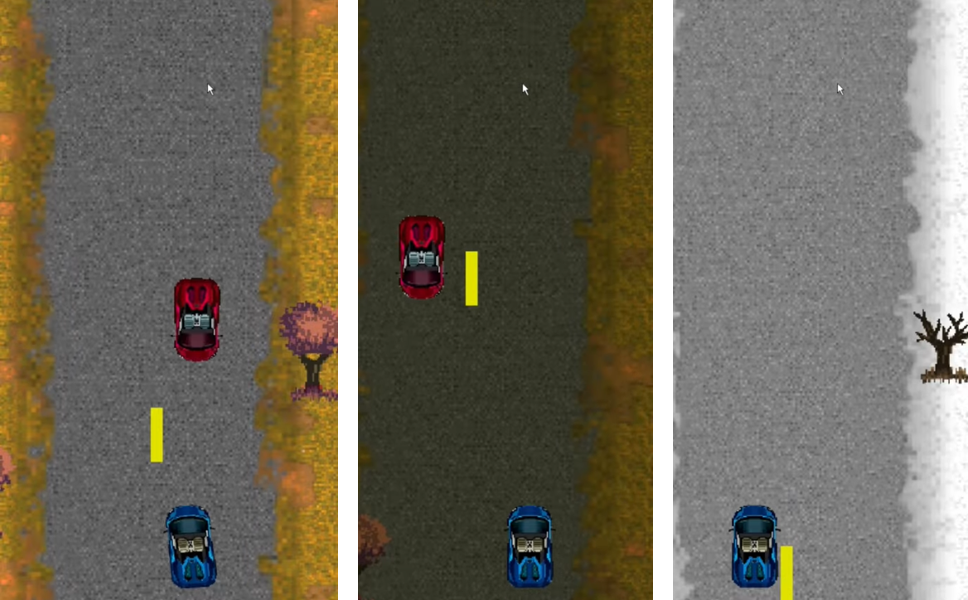

# 賽車閃避小遊戲（Pygame）

> 高二上學期（112 學年，2023 年秋）多元選修課作品，與**楊鈞翔共同協作**完成。

這是我第一個 Pygame 作品，一款 2D 縱向捲軸賽車遊戲：用左右鍵開車，閃避路邊的樹和迎面而來的車。分數越高，季節（春、秋、冬）和日夜就會跟著切換。



▶ 遊玩影片：https://youtu.be/HCPuniSNP9U

## 執行方式

```bash
pip install pygame
python game.py
```

操作：空白鍵開始，← → 移動。

## 版本

| 版本 | 位置 | 內容 |
|---|---|---|
| v1 | `early_versions/v1/` | 第一次畫出車子、草地、道路，可以左右移動 |
| v2 | `early_versions/v2/` | 加入路邊的樹、隨機出現的第二台車，以及碰撞判定 |
| v3 | 根目錄 `game.py` | 季節與日夜切換、開場倒數動畫、撞車爆炸、Game Over 動畫、分數 |
| 實驗 | `game_deer_experiment.py` | 想加入隨機穿越馬路的鹿群，最後沒有來得及完成 |

當初的動機、心得與程式說明放在 `docs/`。

> commit 日期是依學期推估的，檔案本身在 2025-02-05 被重新整理過。

## 當時的設計

- **用字典集中管理圖片**：把檔名和縮放尺寸寫成 `image_files` 字典，一個迴圈統一載入，換素材時只要改字典。
- **季節與日夜分開切換**：`season_change()` 依 `season_score` 每 1000 分輪換春、秋、冬；`replacement()` 依 `Time_score` 每 500 分切換日夜，兩個計數器各自獨立。
- **動畫用圖片序列**：開場動畫、爆炸、Game Over 都是一組編號圖片依序播放。

## 當時沒做完的

簡報裡的反思寫到「未能加入隨機鹿群和計分計時器」，`game_deer_experiment.py` 就是鹿群的半成品。

## 現在回頭看

- v1 的路徑寫成 `"resources\image\car.png"`，只能在 Windows 上執行；v2 改用 `os.path.join` 傳多個參數，才真正跨平台。
- v3 全部寫在一個檔案裡，靠很多 `global` 變數在函式之間傳遞狀態（例如 `reset_game()` 一次要重設十幾個變數）。下一個作品 [2.5D 射擊遊戲](https://github.com/1142028/zombie-shooter-pygame) 的動機就是：做完這個遊戲後覺得程式難讀、難擴充，所以改練模組化。
- 碰撞判定是手寫的座標比較，每一組物件都要寫一次；改用 `pygame.Rect.colliderect` 會簡潔很多。
